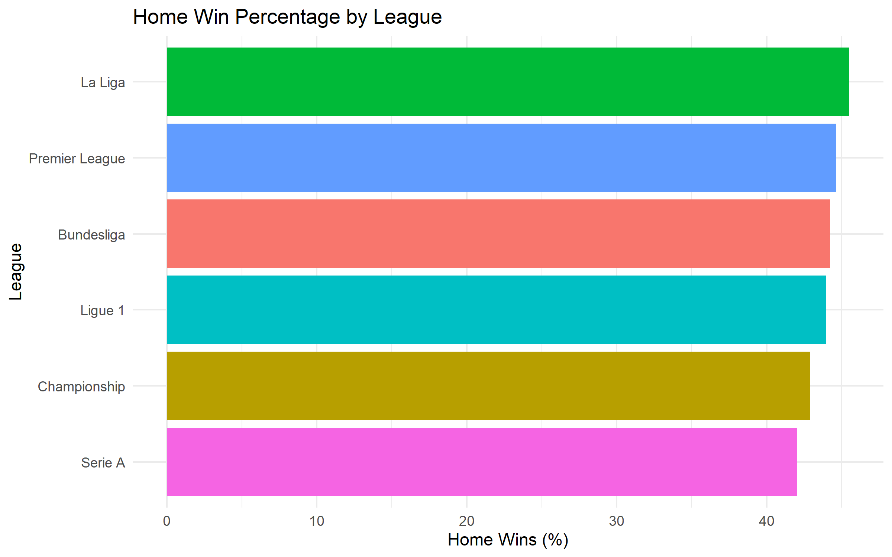
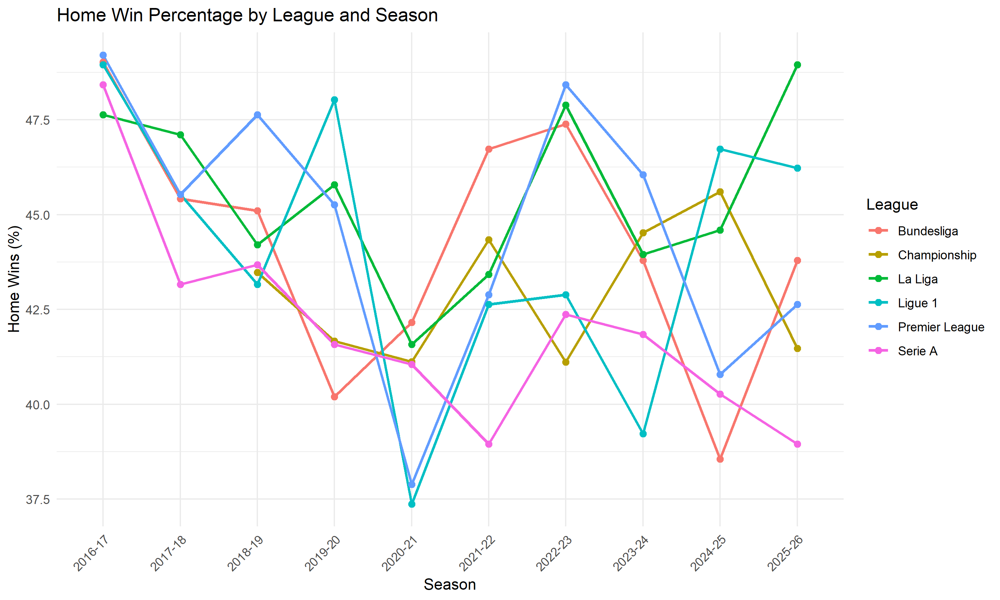

# 1. Business Understanding

## Research Question

How do home win percentages differ across six European football leagues between the 2016/17 and 2025/26 seasons?

## Project Objective

Playing at home may give football teams an advantage because they are familiar with their stadium and have support from home fans. However, this advantage may not be the same in every league. Comparing home win percentages can help us understand whether there are differences between European football leagues.

In this project, I use football match data from the 2016/17 to 2025/26 seasons to compare home win percentages across six European leagues.

The analysis focuses on the Premier League, Championship, La Liga, Bundesliga, Serie A and Ligue 1.

It also examines how home win percentages change across seasons.

## Success Criteria

The project will be considered successful if it can calculate home win percentages for each league, compare the results and identify changes across seasons.

The results should be presented clearly using tables and visualisations.

# 2. Data Understanding

The dataset was obtained from OpenFootball and contains match results from six European football leagues between the 2016/17 and 2025/26 seasons.

The dataset contains 22,479 observations and 15 variables.

The main variables used in this analysis include league, season, home goals and away goals.

These variables allow match outcomes to be identified and home win percentages to be calculated.

The league variable identifies which competition each match belongs to, while the season variable shows when the match was played. Home goals and away goals record the number of goals scored by each team. These two variables are important because they are used to determine whether the home team won the match.

Before starting the analysis, I checked the structure of the dataset in R. This helped me understand which variables were available and whether they could be used to answer the research question. I also checked for missing values because incomplete match results could affect the calculation of home win percentages.

# 3. Data Preparation

The dataset was imported into R from a CSV file.

The relevant variables were selected for the analysis, including league, season, home goals and away goals.

Match results were classified by comparing the number of goals scored by the home and away teams.

A home win was identified when the home team scored more goals than the away team.

The data was then grouped by league and season to calculate home win percentages.

Before calculating the results, I checked the data for missing values. Matches with missing home or away goal values were removed because their results could not be determined. I then created a new variable called home_win. This variable is TRUE when the home team scores more goals than the away team and FALSE otherwise.

Matches that ended in a draw were not counted as home wins. The same rule was applied when the away team scored more goals. However, these matches were still included in the total number of valid matches. This is important because the home win percentage should represent the proportion of all valid matches that were won by the home team.

# 4. Modelling

This project uses descriptive statistical analysis rather than a predictive model.

Home win percentage was calculated using the following formula:

Home Win Percentage = (Number of Home Wins / Total Number of Matches) × 100

The calculation was performed separately for each league and season.

The results were summarised in tables and visualised using bar charts and line charts created with ggplot2.

The bar chart compares overall home win percentages across leagues, while the line chart shows changes across seasons.

I used descriptive statistics because the main purpose of this project is to compare existing match results rather than predict future matches. Calculating percentages makes it easier to compare leagues with different numbers of matches. I used ggplot2 to create charts because they make the differences between leagues and seasons easier to see.

# 5. Evaluation
### Home Win Percentage by League

### Interpretation

La Liga has the highest home win percentage at 45.51%,
while Serie A has the lowest at 42.03%.

The difference between the two leagues is 3.48 percentage
points, suggesting that home win percentages are relatively
similar across the six leagues.

However, home win percentage alone cannot fully explain home advantage because team strength and away performance are not considered.

The Premier League has a home win percentage of 44.63%, followed by the Bundesliga at 44.22% and Ligue 1 at 43.96%. The Championship has a lower percentage of 42.92%. All six leagues have home win percentages between 42% and 46%.

Although La Liga has the highest percentage, the difference between the leagues is not very large. This suggests that home wins occur at relatively similar rates across the six competitions. However, these percentages do not show whether the differences are statistically significant.

### Home Win Percentage by League and Season

### Seasonal Trends

The line chart shows that home win percentages vary across
seasons in all six football leagues.

There is no consistent upward or downward trend across
all leagues during the period studied.

Some leagues experienced noticeable changes between
seasons, suggesting that home win percentages are not
constant over time.

These results show the importance of examining both
overall league averages and seasonal differences.

One noticeable result in the line chart is the change in the Premier League during the 2020/21 season. The home win percentage was lower than in the previous seasons, but it increased again in the following seasons. This shows that home win percentages can change considerably over time, even within the same league. However, the chart does not explain why these changes happened. More information would be needed to investigate the possible reasons.

# 6. Deployment
The results of this analysis are presented in a Quarto HTML report, supported by visualisations and summary tables.

The analysis compares home win percentages across six European football leagues from the 2016/17 to 2025/26 seasons.

The results may be useful for football fans, researchers and analysts who are interested in comparing home match performance across leagues.

Future analysis could examine away win percentages, draws and differences in team strength to provide a more complete understanding of home advantage.

The GitHub repository contains the R script and the dataset used in this project. Other users can download these files and run the analysis in RStudio. The script calculates the home win percentages and produces the charts used in the report. This makes it easier to check the results and repeat the analysis.